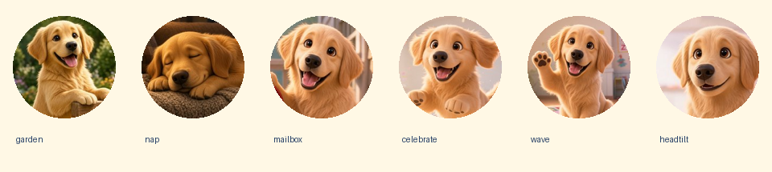

Item 5 means every player, in every layout, hears a short, gentle, varied Lucy recording after a wrong answer, using the existing voice pipeline, without overlapping other speech and with offline support.

# Call-list pass

## TL;DR

Items 1–5 are implemented and pushed to `codex/home-flow-ribbon`. There are six Lucy profile pictures, the portal controls and deletion dialog are corrected, every grown-up has a self-reset action in My account, and wrong answers play three varied Lucy clips. All 370 pre-existing live profiles and their password hashes, links, and settings match the before snapshot. Brandy's profile and progress also match. The sole disposable live account was removed by exact ID.

## Per-item results and design decisions

| Item | Status | Result and design decision |
| --- | --- | --- |
| 1. Lucy profile pictures | Done | Replaced all five emoji option sets with six approved Lucy portraits. Uploads remain. Saved Lucy choices use the existing JPEG data-image format, so no avatar schema change or bulk profile rewrite was needed. Existing emoji profiles display a Lucy fallback without saving a change to those profiles. |
| 2. Sign-out overlap | Done | Portal sign-out occupies header space and wraps with the header. It no longer floats over the roster. |
| 2. Repeated progress buttons | Not a bug | The two buttons belong to separate child rows. Kept one action per child, with an accessible name identifying that child. Removing one would remove a child's progress access. |
| 2. Portal header | Done | Game settings uses navy text in normal and visited states at every width. Selected tabs, keyboard focus, and permissions remain intact. |
| 2. Delete grown-up dialog | Done | The order is consequences, account identities, typed-count confirmation, feedback, and then Cancel / Permanently delete. Delete stays disabled until the exact count is entered. The same ordering correction applies to the kid confirmation. |
| 2. Account label and master wording | Done | “Additional administrator” is a stored display name, not a second role. Kept the name and login intact. Explained that kids without another linked grown-up stay linked to the master account, preserving the existing behavior. |
| 3. Self progress reset | Done | Added **Reset my game progress…** beside the personal progress summary in **My account**. The game account-menu link opens that view directly for grown-ups. A confirmation explains that login, picture, password, settings, and linked kids stay. The server derives the reset target from the authenticated grown-up. Both master and regular self-reset are covered by isolated tests; the regular case is also verified live. |
| 4. Preserve Bradley's changes | Done | No restoration, password rollback, setting rollback, or deletion of pre-existing accounts. Read-only fingerprints match before and after. Only the account created for this job was removed. |
| 5. Lucy wrong-answer speech | Done | Generated one take each of “Uh-oh,” “Try again,” and “Oops, try again.” The handler cycles them with a random starting position. They use the existing speech sequence, volume, mute, visibility cancellation, and navigation cancellation. All three are cached offline and inventoried with hashes. |

The six chosen sources are `01-garden-b-1.jpg`, `03-nap-1.jpg`, `07-seedream-letterpost-mailbox.png`, `09-seedream-celebrate-leap.png`, `10-seedream-classroom-wave.png`, and `11-seedream-headtilt-nudge.png`. Their 192 × 192 JPEG derivatives total 54,434 bytes. [The crop script](../scripts/build-lucy-avatars.py) reproduces them from the supplied approved sources.

## Scope and backend deployment

The approved account-menu change is confined to `accounts/navigation.js`: the existing avatar shows the chosen Lucy picture, legacy emojis have a Lucy fallback, and grown-up Profile and progress links open My account. The offline manifest includes all six derivatives.

Item 5 adds only the wrong-answer hook in `v1-letter-post/app.js` and `v3-moonboat/app.js`. Ribbon Road already shares Letter Post's application script. These hooks use the existing `voice()` player. No layout definition, picker, layout art, default layout, or other gameplay behavior was changed. No further work from Brandy's separate request was started beyond the sound add-on Bradley explicitly included.

The new migration is `20261021032913_grownup_self_reset.sql`, matching Supabase's applied version. It defines a service-role-only, security-invoker function for self-reset. It increments the existing progress generation and deletes only that grown-up's round events. Existing stale-round rejection prevents offline devices from restoring cleared progress. No older migration was edited.

The `accounts` Edge function was deployed as version 8 only to `ixjbgshhzeaosrzavssr`. Its existing Auth bearer validation and session validation remain in place. The existing action for the master resetting another regular grown-up is unchanged. The live direct-RPC denial check passed. Security advisors reported the same existing findings; the new function adds no security-definer exposure.

The three clips use `FgiNpTIapnCbaD6xiqIo`, `eleven_v4`, and the same `creative_generate_speech` pipeline recorded for the existing clips. No custom numerical voice settings were recorded in the supplied notes; the speech tool defaults were retained, with a `[gently]` delivery tag. Only three takes were generated, costing 59 credits total. Durations are 1.36, 1.44, and 2.16 seconds. [Audio provenance](../audio/feedback/SOURCE-AUDIO-NOTES.md) and [the voice manifest](../voice-manifest.json) record the prompts, generation IDs, and hashes. [ElevenLabs flow](https://elevenlabs.io/app/flows/ObIg2KwAqdvA9GosB4lL).

## Before and after screenshots

The baseline screenshots were captured from `d87c220` before implementation, using isolated account fixtures. The hosted after screenshots use the pushed frontend and isolated account fixtures. Neither set represents a login to Brandy's live account.

| Screen | Before, 390 px | Hosted after, 390 px | Hosted after, 768 px | Hosted after, 1440 px |
| --- | --- | --- | --- | --- |
| Header, sign-out, and child actions | [Before](call-list-before/kids-390.png) | [After](call-list-hosted/kids-390.png) | [After](call-list-hosted/kids-768.png) | [After](call-list-hosted/kids-1440.png) |
| Delete grown-up confirmation | [Before](call-list-before/delete-dialog-390.png) | [After](call-list-hosted/delete-dialog-390.png) | [After](call-list-hosted/delete-dialog-768.png) | [After](call-list-hosted/delete-dialog-1440.png) |
| Profile choices | [Before](call-list-before/profile-options-390.png) | [Six Lucy choices](call-list-hosted/profile-options-390.png) | [Six Lucy choices](call-list-hosted/profile-options-768.png) | [Six Lucy choices](call-list-hosted/profile-options-1440.png) |
| Self progress reset | Previously unavailable in My account | [Confirmation](call-list-hosted/self-reset-390.png) | [Confirmation](call-list-hosted/self-reset-768.png) | [Confirmation](call-list-hosted/self-reset-1440.png) |

The [baseline folder](call-list-before/) also contains the 768 and 1440 px before screenshots. [Local after screenshots](call-list-after/) are retained separately.

## Verification

**31 isolated suite/check entries pass.** [Final results](call-list-tests/results.json) retain each command and exit code. Run `python3 scripts/run-call-list-checks.py` to repeat the isolated checks. The batch covers static assets and all 94 voice-file hashes, database and Edge authorization, session limits, settings, account sync, portal flows, all six browser-smoke shards, motion, Ribbon Road, confetti, and strict Edge TypeScript checks. The added call-list suites cover self-reset, native speech, and offline caching.

The game runtime suite passed 234 rounds across all three layouts, with two wrong answers per round, varied retry clips, sequential speech, and mute. The broader real-browser suite passed all 18 game/width/theme cases. Hosted checks and the disposable live checks below are additional to the isolated suite results.

The first new database audit failed because its fixture read role lacked access to the fixture Auth schema. The test's snapshot read was corrected, then it passed. [Initial results](call-list-tests/initial-results.json) preserve that failure; [the passing rerun](call-list-tests/call_list_database-rerun.log) is referenced by the final results. The initial hosted navigation attempts encountered raw.githack's entry screen; the test harness now opens that screen before driving the app. An older offline probe's shutdown output was separated into an initial diagnostic log; the report links to a fresh, passing hosted offline run.

Hosted checks passed at **390, 768, and 1440 px**. These cover all six profile choices and upload persistence, one progress action per child, sign-out spacing, navy settings text, dialog order and count gating, all three game account menus, and master and regular self-reset fixtures. [Hosted browser log](call-list-hosted-browser.log).

The dedicated native audio checks cover grown-ups at 390 px, kids at 768 px, and guests at 1440 px in all three layouts. Every wrong answer plays one of the new MP3s; three successive answers produce three distinct clips. No speech overlap was observed. Mute and Escape cancellation passed. [Local audio log](call-list-sounds.log), [hosted audio log](call-list-hosted-sounds.log).

A real service-worker installation served the reloaded portal, all six JPEGs, and all three MP3s while the browser was offline. [Local offline log](call-list-offline.log), [hosted offline log](call-list-hosted-offline-final.log).

The disposable-account test ran against live Supabase from both localhost and raw.githack. It verified reset persistence, Lucy avatar persistence, rejection of another browser's stale offline round, and denial of direct authenticated calls to the private reset RPC. [Local live log](call-list-live.log), [hosted live log](call-list-hosted-live.log).

The older live suites that sign into the master were deliberately not run. This excludes `portal_master`, `portal_master_edit`, `portal_round2`, the live modes of `portal_flow` and `accounts_sync`, `child_settings_browser`, `child_settings_hosted`, `fixlist_live`, and `portal_review_live`. They require a live master login, which conflicts with the read-only master guard. Master behavior was exercised with isolated database, Edge, and browser fixtures. Live self-reset used only this job's disposable non-master account. Existing-account live probes were also excluded so they could not reuse a deleted account, alter settings, or write progress on pre-existing records.

## Read-only preservation checks

[Before audit](call-list-before-audit.json), [after audit](call-list-after-audit.json), and [comparison results](call-list-preservation.json) retain the evidence. [The comparison script](../scripts/compare-call-list-audits.py) checks the captured results without making network requests or changing the database.

| Check | Before and after |
| --- | --- |
| Master | `brandy`, display name `Brandy`, ID `f41a99f8-2952-49d0-982c-70485b142e0d`; exactly one master |
| Master profile fingerprint | `70d81cda8ce9108d517357fa26263f8d`, unchanged |
| Master progress fingerprint | `5af9775573841826f4af48b060bcd347`, unchanged |
| Pre-existing profiles | Same 370 IDs and identical per-profile fingerprints |
| Passwords | Identical fingerprints for every pre-existing Auth user |
| Guardian links | Identical fingerprint |
| Global and child settings | Identical fingerprints |
| Disposable live account | Removed by exact ID; no remaining Auth user |

No master login, profile write, password change, or progress reset was performed. No pre-existing account or kid was deleted or restored. These checks compare current state; they do not replay an earlier database snapshot.

## Test logins

| Environment | Login | Password | Lifecycle |
| --- | --- | --- | --- |
| Isolated browser fixtures | `call_master`, `call_regular`, `call_ava`, `call_leo` | `7234ab` | In-memory fixtures only |
| Isolated audio fixtures | `sound_adult`, `sound_kid` | `7234ab` | In-memory fixtures only; guest mode also checked |
| Live disposable grown-up | `call_164f84a1e37a` | `LucyCall2026!` | Created for this job, then removed by exact ID `d5275b62-4dab-4389-8271-873d92ddff0c` |

The remaining regression suites use their own isolated fixtures. The live login is retained here as test evidence and no longer works.

## Commits and branch guards

Before the first commit, local HEAD, `origin/codex/home-flow-ribbon`, and the remote rollback branch all resolved to `d87c2201c97e619168a7be326fee35acc996ea8c`. No rollback branch or `main` was changed, and no push was forced.

- `0c6d13d` — Allow grown-ups to reset only their own game progress.
- `36a18b2` — Add Lucy profile pictures, portal fixes, and gentle retry speech.
- `9a5c1f0` — Verify hosted call-list checks and align the applied migration.
- `3642eac` — Record call-list verification, screenshots, and live-data preservation.

The final verification and report commits are recorded in the branch history. The repository redirects to `TeslaWarpDrive/childrens-learning-game`; pushes used the existing repository credential helper after the default helper proved unavailable.

## Always-latest hosted links

These links follow the working branch rather than a pinned commit. raw.githack may show its **Open the page** screen first.

- [Game entry](https://raw.githack.com/TeslaWarpDrive/childrens-learning-game/codex/home-flow-ribbon/index.html)
- [Grown-up portal](https://raw.githack.com/TeslaWarpDrive/childrens-learning-game/codex/home-flow-ribbon/accounts/index.html)
- [My account and personal progress](https://raw.githack.com/TeslaWarpDrive/childrens-learning-game/codex/home-flow-ribbon/accounts/index.html#account)
- [Ribbon Road](https://raw.githack.com/TeslaWarpDrive/childrens-learning-game/codex/home-flow-ribbon/v4-silk-thread/index.html)
- [Letter Post](https://raw.githack.com/TeslaWarpDrive/childrens-learning-game/codex/home-flow-ribbon/v1-letter-post/index.html)
- [Moonboat](https://raw.githack.com/TeslaWarpDrive/childrens-learning-game/codex/home-flow-ribbon/v3-moonboat/index.html)
